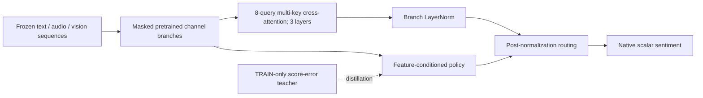

# Multimodal Sentiment Fusion

[中文](README.zh-CN.md) · [Architecture](docs/ARCHITECTURE.md) · [Experiments](docs/EXPERIMENTS.md) · [Reproduction](docs/REPRODUCING.md) · [Contributing](CONTRIBUTING.md)

An experimental research project for **native continuous multimodal sentiment
prediction** on CH-SIMS v2.0 and CMU-MOSEI. It includes sequence fusion models,
matched baselines, source-isolated training, independent evaluation and
preserved negative results. The Python package remains `jevaffect`.

**Current result:** the implemented distilled sequence-routing candidate has
completed three seeds, but does **not** consistently beat its matched controls.
This is a reproducible research snapshot, not a verified novel-method release
or a state-of-the-art claim. All displayed results are development VALID;
the final TEST split remains independent of this model-selection study.

## Start with the architecture



The core hypothesis is that a target-free policy can learn useful modality
preferences from TRAIN-only channel errors, with routing placed after
normalization. The candidate has 2,084,871 parameters excluding frozen encoders.
[Exact architecture and seven controls](docs/ARCHITECTURE.md) explain masks,
pretraining, losses, inference and the relationship to KuDA/ALMT and Jev.
Jev's weights and proprietary training recipe are not included.

## Actual results

CH-SIMS v2 official VALID, 647 clips; native clipped MAE ↓, mean ± sample SD
over seeds 13/42/2026. All seven fusion arms share the same features, branch
pretraining, initialization and 50-epoch budget.

| Matched arm | MAE ↓ |
|---|---:|
| Static sequence fusion | 0.378832 ± 0.007309 |
| Distilled-static auxiliary control | 0.378253 ± 0.008851 |
| Teacher post-normalization control | 0.378011 ± 0.008966 |
| **Distilled post-normalization candidate** | **0.378497 ± 0.007455** |
| Learned post-normalization, no KL | 0.379303 ± 0.007723 |

The candidate fails the preregistered all-seed gain requirement. The older
M-only standardized sequence ALMT baseline scores 0.408680 ± 0.006690; the
new family has extra native channel pretraining, so that comparison does not
isolate a routing gain. Separate MOSEI author-feature ALMT scores
0.611524 ± 0.005063 under MOSEI's native protocol. [Full table, controls,
failure analysis and historical experiments](docs/EXPERIMENTS.md).

## Code-only quick start

Python 3.12 is the measured runtime. A CPU demonstration needs no data or weights:

```bash
git clone https://github.com/MaYangle/Multimodal-Sentiment-Fusion.git
cd Multimodal-Sentiment-Fusion
python -m venv .venv
# Windows: .venv/Scripts/Activate.ps1
# Linux/macOS: source .venv/bin/activate
python -m pip install -e ".[train,data,encoders,verify,uncertainty]"
python scripts/demo_sequence_architecture.py
python -m unittest discover -s tests
```

The demo uses **synthetic inputs and random weights** to show the implemented
network and missing-modality route contract; its scores are not accuracy results.
[Exact CUDA environment, training, resume, audit and trained baseline inference
commands](docs/REPRODUCING.md) require separately acquired inputs and checkpoints.

## Data and evaluation

| Dataset | Native task / cohort | Available input and limitation |
|---|---|---|
| [CH-SIMS v2.0](https://thuiar.github.io/sims.github.io/chsims) | Native M/T/A/V; CSV 2,722/647/1,034, total 4,403 (homepage says 4,402) | Completed experiments use author-ID-matched competition media with frozen MacBERT/WavLM/DINOv2 features. Full author raw-media identity is unverified; 17 TRAIN/VALID author videos acquired, full author feature pickle incomplete. |
| [CMU-MOSEI SDK](https://github.com/CMU-MultiComp-Lab/CMU-MultimodalSDK) | Native M [-3,3]; SDK-linked MultiBench 16,265/1,869/4,643 | Complete verified author-linked pre-extracted features. Raw media unavailable; four TRAIN fold discrepancies retained and disclosed. |

CH uses native [-1,1] evaluation clipping, positive >0 with zero negative;
MOSEI uses unclipped regression plus its own Has0/Non0 and rounded-class rules.
Datasets are trained and evaluated separately. [Native metrics and split
protocol](docs/NATIVE_EVALUATION_PROTOCOL.md), [data acquisition status](docs/AUTHOR_ACQUISITION_STATUS.md)
and [MOSEI cohort](docs/MOSEI_MULTIBENCH_COHORT.md) document exact limitations.

## Reproduce or extend

- `jevaffect/`: models, native metrics, staged training, caches and inference.
- `scripts/`: preparation, training/resume, independent audits and demos.
- `configs/`: frozen experiment budgets and baseline configurations.
- `tests/`: split isolation, metrics, masks, optimizer/checkpoint resume contracts.
- `docs/`: architecture, full experiment process, closest-work reviews and failures.
- `vendor/`: attributed baseline source with upstream licenses.

The completed gate matrix has 27 cells and took about 2.22 hours of recorded
fit time on RTX 5070 Ti 16 GB, excluding encoder extraction/download/audits.
Checkpoints, logs and per-sample predictions are saved locally. Checkpoint
downloads are not yet published; train from the supplied configs. The public
tree excludes datasets/weights and publishes redacted report summaries where
needed; [publication boundary](docs/PUBLICATION_SCOPE.md).

Fresh-environment baseline reproductions have completed, but a fresh full
repeat of the latest gate matrix, full author media, MOSEI method replication,
final TEST evaluation and stable algorithmic improvement remain pending.
Historical commands and prior findings remain reachable in the
[archived English README](docs/HISTORICAL_README.md) and
[Chinese README](docs/HISTORICAL_README.zh-CN.md); current status supersedes them.

Contributions can add a gate-checkpoint inference CLI, verify author media,
reproduce matched baselines, or test a preregistered utility-based routing
hypothesis. See [CONTRIBUTING.md](CONTRIBUTING.md) for concrete contracts.

## Attribution and citation

Original code is [MIT](LICENSE). [Third-party notices](THIRD_PARTY_NOTICES.md)
cover baseline code, encoders, Jev and separate data/model conditions. Cite
the upstream dataset/method papers when using them. Until a paper is available,
cite this repository URL together with the exact commit and experiment config.
The [legacy migration record](docs/GITHUB_MIGRATION_20261014.md) documents the
verified backup and deletion of the previous repository.
