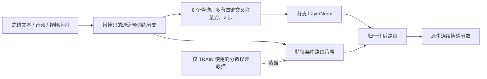

# Multimodal Sentiment Fusion

[English](README.md) · [模型架构](docs/ARCHITECTURE.md) · [完整实验](docs/EXPERIMENTS.md) · [复现步骤](docs/REPRODUCING.md) · [参与贡献](CONTRIBUTING.md)

面向 **CH-SIMS v2.0 与 CMU-MOSEI 原生连续情感预测** 的研究项目，提供时序多模态融合网络、匹配基线、来源隔离训练、独立评估，以及保留的失败实验。Python 包名保留为 `jevaffect`，兼容已训练检查点。

**当前结论：**新的蒸馏时序路由网络已经完成三随机种子训练，但没有稳定超越匹配对照。本仓库发布实际研究代码与证据；尚未证明原创方法收益或达到 SOTA。下面的结果均为开发阶段 VALID，最终 TEST 保持独立。

## 网络架构与核心假设



核心假设：利用 TRAIN 中各通道预测误差训练教师，蒸馏成推理时不需要标签的模态策略，并将路由放在归一化后，使模态偏好真正影响融合。候选网络有 2,084,871 个参数，不含冻结编码器。[架构文档](docs/ARCHITECTURE.md)详细说明掩码、通道预训练、损失、七个对照及与 KuDA/ALMT/Jev 的关系。Jev 权重和专有训练配方不包含在项目中；这是独立实现的假设。

## 实际实验结果

CH-SIMS v2 官方 VALID 共 647 条，原生裁剪 MAE 越低越好。数值为种子 13/42/2026 的均值 ± 样本标准差；七个融合对照共用输入、通道预训练、初始化与 50 轮预算。

| 匹配对照 | MAE ↓ |
|---|---:|
| 静态时序融合 | 0.378832 ± 0.007309 |
| 蒸馏但不执行路由的静态对照 | 0.378253 ± 0.008851 |
| 教师驱动归一化后路由对照 | 0.378011 ± 0.008966 |
| **蒸馏归一化后路由候选** | **0.378497 ± 0.007455** |
| 无 KL 的学习路由对照 | 0.379303 ± 0.007723 |

候选没有通过预注册的逐种子收益门槛。较早的仅 M 监督标准化时序 ALMT 为 0.408680 ± 0.006690；新网络族额外使用通道预训练，因此该差值不能证明路由创新有效。MOSEI 作者关联特征上的独立 ALMT 基线为 0.611524 ± 0.005063，按其原生协议计算。[完整逐种子结果、消融、失败分析与历史研究](docs/EXPERIMENTS.md)。

## 无数据快速运行

实际测量使用 Python 3.12。下列 CPU 演示无需下载数据和权重：

```bash
git clone https://github.com/MaYangle/Multimodal-Sentiment-Fusion.git
cd Multimodal-Sentiment-Fusion
python -m venv .venv
# Windows: .venv/Scripts/Activate.ps1
# Linux/macOS: source .venv/bin/activate
python -m pip install torch==2.11.0 --index-url https://download.pytorch.org/whl/cpu
python -m pip install -c configs/ci_cpu_constraints.txt -e ".[train,data,encoders,verify,uncertainty]"
python scripts/demo_sequence_architecture.py
python -m unittest discover -s tests
```

演示使用**合成输入和随机权重**，展示架构前向传播及模态缺失时的路由约定，不代表训练后准确率。[复现文档](docs/REPRODUCING.md)提供实际 CUDA 环境、数据准备、正式训练、断点恢复、独立审计与基线推理命令；这些路径需要自行取得合法输入与检查点。

## 数据与原生评估

| 数据集 | 原生任务与样本 | 当前输入及限制 |
|---|---|---|
| [CH-SIMS v2.0 作者页面](https://thuiar.github.io/sims.github.io/chsims) | M/T/A/V 原生分数；CSV 划分 2,722/647/1,034，共 4,403，作者网页写 4,402 | 完整实验使用作者 ID 匹配的比赛媒体及冻结 MacBERT/WavLM/DINOv2 自提特征。全量作者媒体字节等价尚未核实；取得 17 条 TRAIN/VALID 作者视频后遭遇配额，作者特征文件仍不完整。 |
| [CMU-MOSEI 作者 SDK](https://github.com/CMU-MultiComp-Lab/CMU-MultimodalSDK) | 原生 M [-3,3]；SDK 关联 MultiBench 为 16,265/1,869/4,643 | 作者关联预提取特征完整并已校验；原始媒体未取得，4 个 TRAIN ID 与当前 SDK 划分不一致，保留并披露。 |

CH 评估按 [-1,1] 裁剪，正类 >0，零中性归负类；MOSEI 回归不裁剪，另按其 Has0/Non0 与舍入分类规则评估。两个数据集分别训练，不人为统一标签。[原生指标协议](docs/NATIVE_EVALUATION_PROTOCOL.md)、[获取状态](docs/AUTHOR_ACQUISITION_STATUS.md)、[MOSEI cohort](docs/MOSEI_MULTIBENCH_COHORT.md)记录细节。

## 复现与继续研究

- `jevaffect/`：模型、指标、分阶段训练、缓存与推理。
- `scripts/`：数据准备、训练恢复、独立审计与演示入口。
- `configs/`：冻结的实验预算与基线配置。
- `tests/`：划分隔离、指标、序列掩码和检查点恢复约定。
- `docs/`：架构、实验过程、近邻工作与失败结果。
- `vendor/`：附带原始许可证的基线代码。

最新研究共 27 个正式单元，在 RTX 5070 Ti 16 GB 上记录的训练总耗时约 2.22 小时，不含下载、编码器提取和独立审计。检查点、日志与逐样本预测已保存本地。权重下载尚未发布，可按配置自行训练。仓库不包含数据与权重，必要的 JSON 报告以标明删减范围的汇总形式发布，见[发布边界](docs/PUBLICATION_SCOPE.md)。

部分基线已在全新环境复现；最新完整路由矩阵的全新环境重跑、全量作者媒体、MOSEI 方法复验、最终 TEST 和稳定创新收益仍待完成。[历史英文 README](docs/HISTORICAL_README.md)和[历史中文 README](docs/HISTORICAL_README.zh-CN.md)保留旧命令、归属与研究记录，其旧状态由当前文档取代。

具体贡献方向包括：补充路由检查点独立推理 CLI、核验作者媒体、复现匹配基线、预注册并验证更直接的模态效用教师。请阅读 [CONTRIBUTING.md](CONTRIBUTING.md)。

## 引用与归属

原创代码采用 [MIT](LICENSE)；[第三方声明](THIRD_PARTY_NOTICES.md)说明基线代码、编码器、Jev 及独立的数据/模型使用条件。使用数据或已有方法时引用其原论文；项目论文尚未发布，可引用仓库 URL、准确提交和实验配置。[迁移记录](docs/GITHUB_MIGRATION_20261014.md)保存旧仓库历史与检查点备份验证、删除事实。
