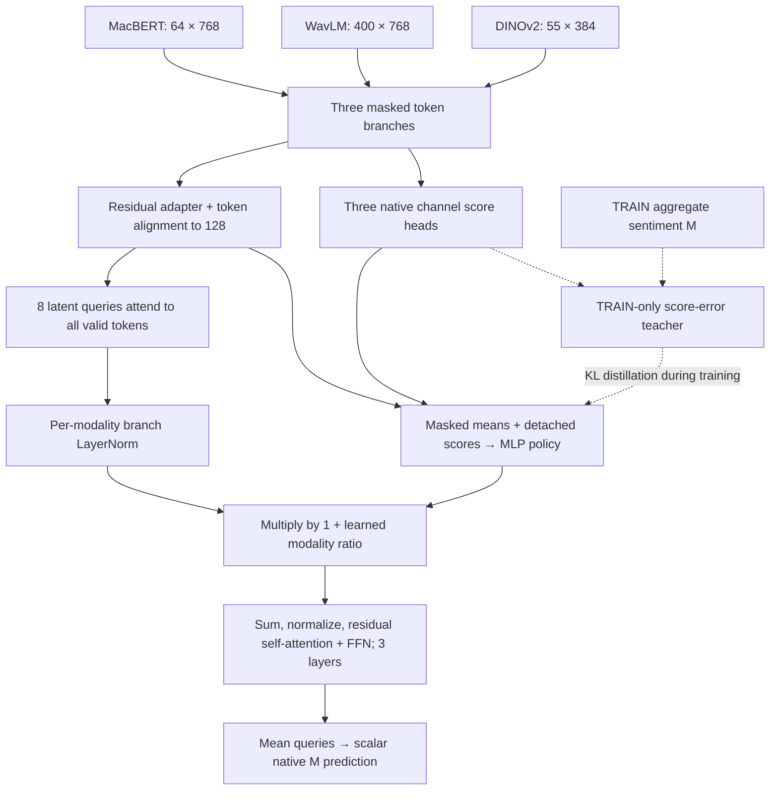

# Architecture and hypothesis

This document describes the implemented `SequenceGateRegressor`, not a verified
new state-of-the-art method. The registered candidate is `distilled_post_norm`.
Its three-seed controlled study failed promotion; see [results](EXPERIMENTS.md).
The frozen [plan](NATIVE_SEQUENCE_GATE_PLAN_V1.md), [source](../jevaffect/sequence_gates.py)
and [trainer](../jevaffect/sequence_gate_training.py) define the exact experiment.

## Question

Can a feature-conditioned deployment policy learn a TRAIN-only score-error
teacher, and can placing routing after branch normalization make that policy
useful when modalities disagree? Scalar scaling before LayerNorm is almost
cancelled. A score close to the aggregate label is a plausible teacher, but
closeness does not establish the modality's causal utility to a fused prediction.

## Implemented candidate

Each branch projects tokens to 128 dimensions, computes a residual
128→64→128 adapter, concatenates the original and adapted representations, and
uses a masked-mean 256→64→32→1 channel decoder. Fusion aligns the concatenated
tokens to 128 dimensions. Eight learned queries receive the sum of modality
masked means, then use three layers with four-head cross-attention and a
256-dimensional feed-forward block. Attention retains multiple valid keys;
pooled one-key attention would erase query/key routing information.

The 387→64→3 policy receives three aligned masked means and three detached
channel scores. It softmaxes over present modalities. Its TRAIN-only teacher is
`softmax(-0.3 * (channel_prediction - M)^2)`, detached before KL distillation.
The scalar loss is raw native M L1 + 0.01 contrastive loss + 0.1 teacher-to-policy
KL for distilled arms. This policy is not a calibrated probability of correctness.

At deployment, the candidate uses features and its predicted channel scores;
it receives no ground-truth label. Evaluation `forward` rejects a supplied
target. Explicit probe methods support interventions, including separately
labelled privileged diagnostics. Padding is zeroed before affine operations;
absent modalities have zero route mass, and all-absent inputs remain finite.
Synthetic mask tests establish this numerical contract, not missing-modality
accuracy on the present fully observed VALID cohort.

There are 2,084,871 parameters, including a 25,027-parameter policy. Stage two
freezes 106,179 adapter/decoder parameters and trains 1,978,692 parameters.
The frozen external encoders are additional and excluded from these counts.

## Matched controls

All seven arms share the same features, branch pretraining per seed, initial
fusion state, parameter count and 50-epoch fusion budget.

| Arm | TRAIN route | Deployment route | Placement | Policy KL |
|---|---|---|---|---|
| `static` | Equal present mass | 1 per present modality | Before LN | No; dormant policy |
| `pre_norm` | Score-error teacher | 1 per present modality | Before LN | No; dormant policy |
| `post_norm` | Score-error teacher | 1 per present modality | After LN | No; dormant policy |
| `distilled_static` | Equal present mass | 1 per present modality | Before LN | Yes; policy not executed |
| `distilled_pre_norm` | Learned policy | Learned policy | Before LN | Yes |
| `distilled_post_norm` | Learned policy | Learned policy | After LN | Yes; registered candidate |
| `learned_post_norm` | Learned policy | Learned policy | After LN | No |

The dormant heads receive no gradient or weight-decay update. The
`distilled_static` control isolates auxiliary distillation from actual routing.
Pre-LN and post-LN controls isolate placement from deployment policy learning.

## Relationship to existing work

The implementation uses established attention, residual adapters, normalization
and distillation. [ALMT](https://github.com/Haoyu-ha/ALMT) supplies a competitive
sequence baseline. The [KuDA adaptation review](NATIVE_KUDA_ADAPTATION_DESIGN_20261014.md)
documents paper/code differences and the source revision; this project does not
copy its per-epoch TEST selection. The [closest-work review](NATIVE_SEQUENCE_GATE_PRIOR_REVIEW_20261014.md)
covers existing dynamic routing and teacher-guided policies. Moving a scalar
gate after normalization is a known operation, not an originality claim.

[Jev](JEV_SCOPE.md) motivates structured decisions and efficient reasoning;
Jev weights, its proprietary training recipe and an official implementation are
not included or dependencies. The current network is an independent hypothesis.
Neither novelty nor improved generalization has been established.
